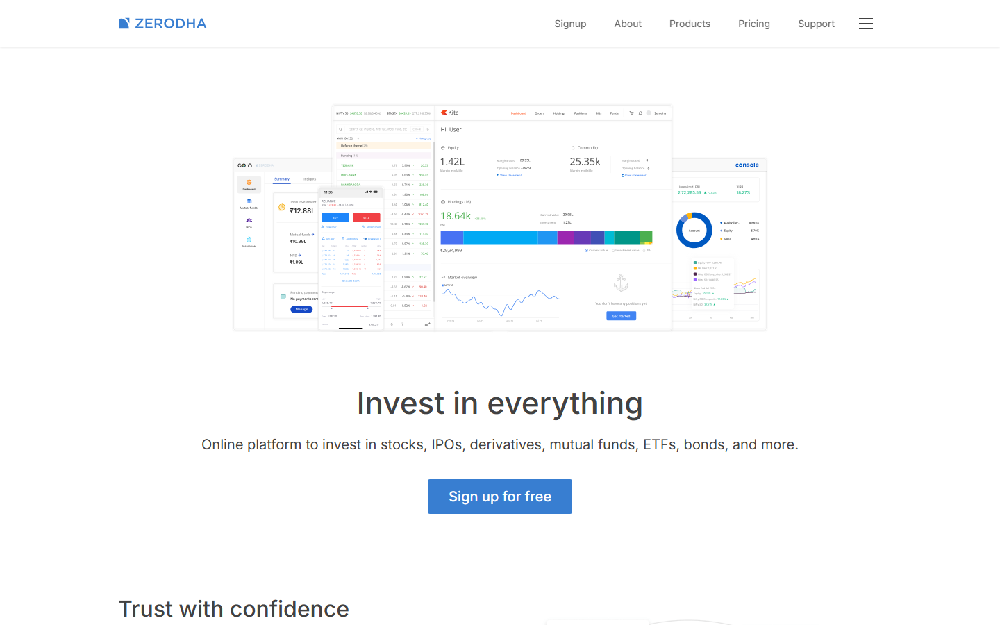
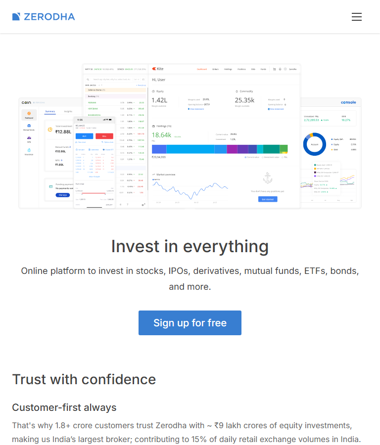
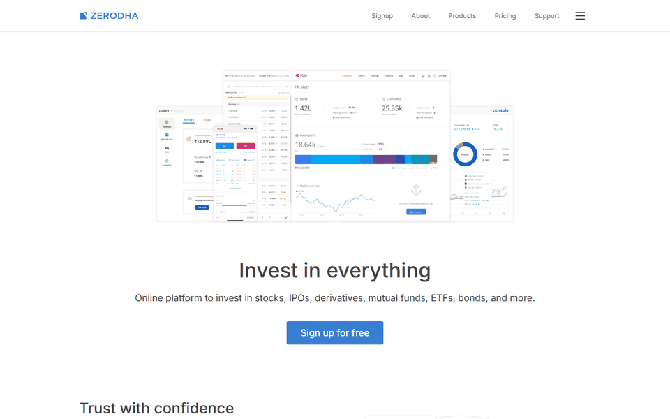
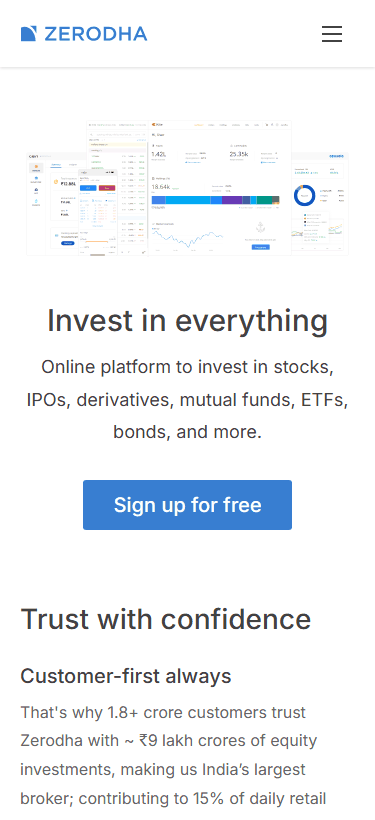
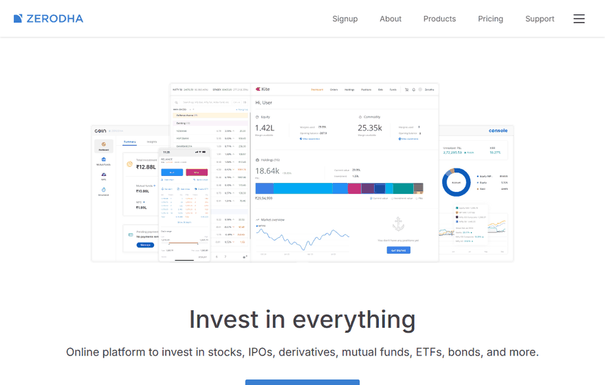

# Zerodha landing page clone

Educational React project based on the SapphireIQ four-module curriculum. Unaffiliated with Zerodha; no trading or account functionality is implemented.

**[View the live deployment →](https://zerodha-landing-page-clone-orpin.vercel.app)**

## Project screenshots

Screenshots captured from the public deployment on 12 October 2026. Click an image to view it at full size.

### Desktop

[](docs/media/desktop.png)

### Tablet and mobile

<a href="docs/media/tablet.png"></a>
<a href="docs/media/mobile.png"></a>

[View the complete landing-page screenshot, including all sections and footer](docs/media/full-page.png).

## Animated project previews

These looping GIFs demonstrate real interactions recorded on the deployed site; they do not add animations to the website. GIF playback may be reduced by your browser or accessibility settings.

### Desktop navigation

Opening the product menu and dismissing it with Escape.



### Mobile navigation

The compact menu reveals navigation, products, utilities and education links.



### Landing-page tour

Scroll through the hero, trust features, ecosystem, pricing, education and account CTA while the header stays visible.



## Development

Node.js 22.12+ (or 20.19+) is required. Run `npm ci`, then `npm run dev`. Run `npm run check` and `npm run build` to verify the project; `npm run preview` serves the production build.

## Stack

React, Vite, plain CSS, locally bundled Inter fonts. Components live in `src/components`, content in `src/data`, static assets in `public/assets`.

## Features and reference

Recreates the official [Zerodha homepage](https://zerodha.com/) inspected on 12 October 2026: sticky logo/navigation, expandable product menu, investing hero, four trust features, ecosystem illustration, Kite Connect banner, three pricing statistics, Varsity and TradingQ&A education, account CTA, and the complete account/support/company/quick-links footer with social links, app badges, legal disclosures, and exchange links.

Features and pricing statistics render from data arrays through reusable cards. Layout uses Flexbox, CSS Grid and media queries at 1000px, 800px and 480px. Includes semantic landmarks, descriptive image alternatives, a skip link, visible keyboard focus, keyboard-operable navigation, Escape dismissal with focus return, and outside-click dismissal.

All product, signup, support, utility, education, social and policy destinations point to their official websites. The local menu works; account creation and trading remain on Zerodha's services. Marketing figures and legal copy are a dated reference snapshot, not statements about this educational project.

## Commands

```sh
npm ci
npm run dev
# http://127.0.0.1:5173
npm run check
npm run build
npm run preview
# http://127.0.0.1:4173
npx playwright install chromium
npm test
```

Browser tests use the production build, so run `npm run build` before `npm test`. The test runner starts its own preview server on port 4173; stop a separately running preview first. Generated test screenshots and reports are ignored by Git. Selected README screenshots and animated previews are intentionally tracked in `docs/media/`.

## Structure

```text
public/assets/        Local reference illustrations, logos, badges, icons
docs/media/           README screenshots and animated interaction previews
src/components/       Navbar, Hero, reusable links/cards/sections, Footer
src/data/             Navigation, feature/pricing arrays, fixed footer copy
src/styles.css        Reset, layout, focus styles and responsive rules
tests/                Navigation, layout/image and footer checks
```

The footer legal HTML is fixed, audited source content. Never replace it with untrusted input without sanitization.

## Curriculum checklist

| Module | Requirement | Implementation / verification |
| --- | --- | --- |
| 1 | React setup, reset, component hierarchy | React + Vite; base CSS; Navbar, Hero, Sections, Footer |
| 2 | Reference navigation/hero, sticky positioning, reusable buttons | Official local assets and reference content; shared signup button; keyboard and sticky-header tests |
| 3 | Data-driven features and statistics, reusable cards, responsive grid | `features` and `pricing` arrays; FeatureCard and PriceCard; Grid with responsive breakpoints |
| 4 | Footer links/legal, mobile/tablet/desktop testing, deployment | Complete footer; Chromium checks at 320, 375, 768, 1024 and 1440px; Vercel and Netlify configs |

The guide supplies no pixel mockup, explicit URL, or numerical scoring rubric; it names Zerodha and asks the hero/navigation to match the live reference. The PDF's module learning objectives and hands-on exercises were used as acceptance criteria. Guide-page branding and its student-directed instructions are not landing-page content.

## Verification

ESLint and production build pass. Eleven Chromium tests cover content headings, data-driven item counts, visible image loading, horizontal overflow, runtime errors, sticky header, keyboard menu behavior, focus return, official CTA/policy URLs, footer copy, outside-click dismissal, page refresh, locally loaded Inter fonts, visible focus outlines, the readable unofficial-clone disclaimer, and absence of data-collection forms. Full-page screenshots are visually inspected at desktop, tablet and mobile widths. Other browser engines and physical devices have not been tested. External destinations are matched to the reference; their future availability is outside this project.

## Deployment

Live production site: https://zerodha-landing-page-clone-orpin.vercel.app

Vercel: run `npx vercel login`, then `npx vercel deploy --prod` from this directory. The existing project uses the Vite preset. `vercel.json` sets the build to `npm run build` and output to `dist`. This is a single-page landing site served at `/`; refreshing the root requires no extra route rewrites. No paid service or upgrade is required.

Deployment changes are committed and pushed to `https://github.com/poojaaxx/zerodha-landing-page-clone` using the verified Git identity. The final production deployment is made from a clean latest commit; the Vercel deployment metadata is checked against that full Git SHA. The same eleven Chromium checks run against the public URL. For future updates: run checks, commit, `git push origin main`, then `npx vercel deploy --prod` (or wait for the linked repository's automatic deployment).

Hosted checks in PowerShell: set `$env:DEPLOYMENT_URL='https://zerodha-landing-page-clone-orpin.vercel.app'`, run `npm test`, then `Remove-Item Env:DEPLOYMENT_URL`.

Netlify: use the supplied `netlify.toml`, with build command `npm run build` and publish directory `dist`, or upload the built `dist` directory through Netlify's dashboard. Deployment requires an authenticated hosting account. See `DEPLOYMENT.md` for the outcome of this session.

## Asset credits and limitations

Local images, product logos, badges and the reference social icon font are from `https://zerodha.com/static/images/` and the homepage's official stylesheet. They remain the property of their respective owners; inclusion is for this educational reproduction, not a grant of redistribution rights. Obtain appropriate permission before commercial reuse. Inter is by Rasmus Andersson, bundled via `@fontsource/inter` under the SIL Open Font License (see the package's LICENSE).

This is an educational clone, not an official Zerodha site or financial service. The title, metadata and footer identify that status. No analytics, accounts, payments, trading backend or fake success flows are included. The layout closely follows the reference while adding accessible interaction behavior and an educational notice. This is a frontend assignment rather than a claim of exact pixel identity or current financial/legal accuracy.
